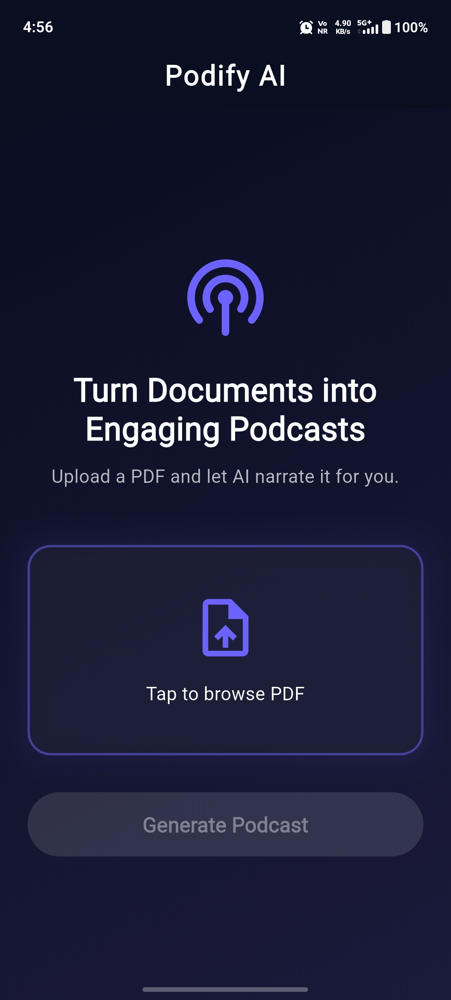
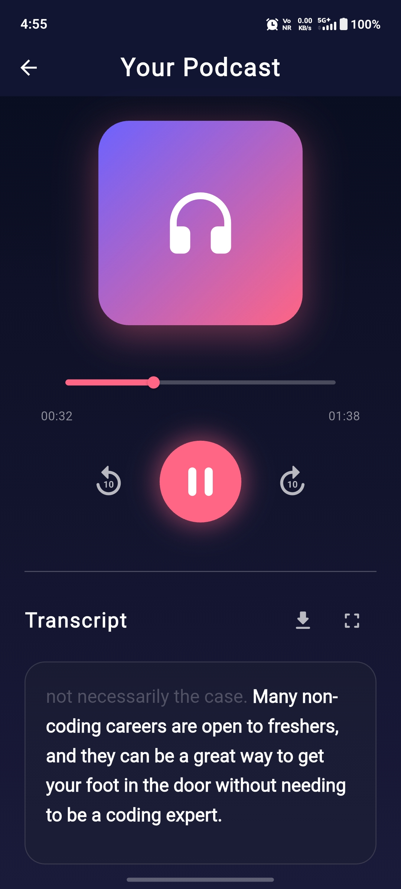
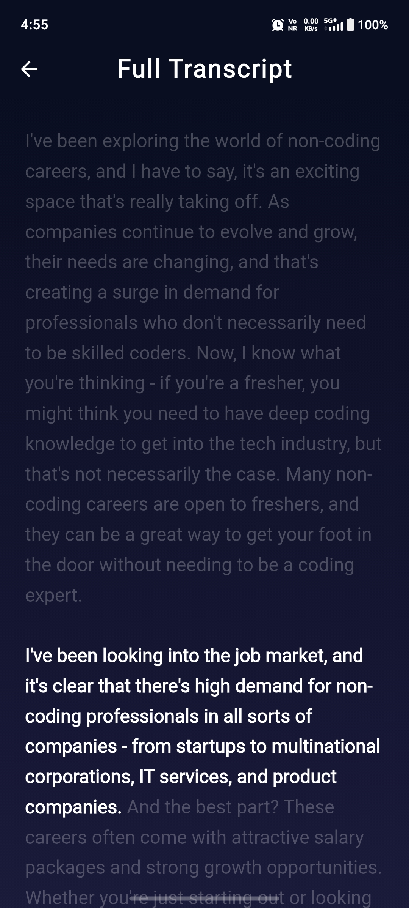
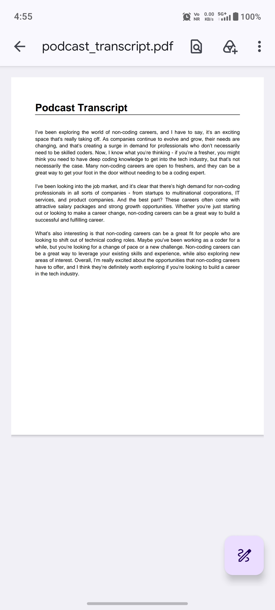

<div align="center">

# 🎙️ PDF Podcast

### Turn lengthy PDF documents into engaging AI-powered podcasts.

**Upload a PDF → Let AI understand it → Generate a podcast → Listen anywhere 🎧**

<br>


\

<br>


\

</div>

---

## ✨ Overview

**PDF Podcast** is an AI-powered application that transforms lengthy PDF documents into engaging, easy-to-listen podcast episodes.

Instead of spending hours reading a long document, users can upload a PDF and let AI extract the important information, generate a podcast-style script, and convert it into an audio episode.

The backend is built with **FastAPI**, while the Flutter application provides the user interface and handles podcast playback and transcript PDF generation.

### 🎯 The idea

> **Read less. Listen more. Learn anywhere.**

---

# 🚀 Features

<table>
<tr>
<td width="50%">

### 📄 PDF Processing

Upload and process PDF documents using **PyMuPDF** to extract readable text.

</td>
<td width="50%">

### 🤖 AI-Powered Processing

Use **Groq's AI infrastructure and Llama 4 Scout** to understand the document and extract important information.

</td>
</tr>

<tr>
<td>

### 🎙️ Podcast Generation

Transform extracted information into a natural, engaging podcast-style script.

</td>
<td>

### 🔊 Text-to-Speech

Convert the generated podcast script into natural speech using **Edge TTS**.

</td>
</tr>

<tr>
<td>

### 🎧 MP3 Podcast

Generate an MP3 podcast that can be streamed directly through the application.

</td>
<td>

### 📜 Transcript

The generated podcast script is returned to the Flutter application and can be displayed as a readable transcript.

</td>
</tr>

<tr>
<td>

### 📥 Transcript PDF

Flutter generates a PDF from the returned transcript and allows the user to save/download it locally.

</td>
<td>

### ⚡ REST API

FastAPI provides a lightweight backend that can be consumed by Flutter, web applications, or other HTTP clients.

</td>
</tr>

<tr>
<td>

### 📚 Large PDF Processing

Uses chunking, overlap, and sampling techniques to process larger documents efficiently.

</td>
<td>

### 🔄 Retry Handling

Handles temporary API failures and rate-limit situations during AI processing.

</td>
</tr>
</table>

---

# 🎬 Demo

## 📱 Application Screenshots

> Add your Flutter application screenshots inside `docs/screenshots/`.

```text
docs/
└── screenshots/
    ├── home.png
    ├── upload.png
    ├── processing.png
    ├── podcast.png
    └── transcript.png
```

Then display them in the README:

<div align="center">






</div>

---

# 🎧 How It Works

```text
                         ┌──────────────────────┐
                         │      Flutter App     │
                         └──────────┬───────────┘
                                    │
                              Upload PDF
                                    │
                                    ▼
                         ┌──────────────────────┐
                         │    FastAPI Backend   │
                         └──────────┬───────────┘
                                    │
                                    ▼
                         ┌──────────────────────┐
                         │   PDF Text           │
                         │   Extraction         │
                         │     PyMuPDF          │
                         └──────────┬───────────┘
                                    │
                                    ▼
                         ┌──────────────────────┐
                         │ Text Chunking &       │
                         │ Sampling              │
                         └──────────┬───────────┘
                                    │
                                    ▼
                         ┌──────────────────────┐
                         │      Groq API        │
                         │    Llama 4 Scout     │
                         └──────────┬───────────┘
                                    │
                                    ▼
                         ┌──────────────────────┐
                         │   Podcast Script     │
                         │     Generation       │
                         └──────────┬───────────┘
                                    │
                                    ▼
                         ┌──────────────────────┐
                         │      Edge TTS        │
                         │   Text → Speech      │
                         └──────────┬───────────┘
                                    │
                                    ▼
                         ┌──────────────────────┐
                         │      MP3 Audio       │
                         └──────────┬───────────┘
                                    │
                                    ▼
                         ┌──────────────────────┐
                         │      Flutter App     │
                         ├──────────────────────┤
                         │ 🎧 Listen            │
                         │ 📜 Read Transcript   │
                         │ 📥 Generate PDF      │
                         └──────────────────────┘
```

---

# 🏗️ System Architecture

```text
                         ┌─────────────────────┐
                         │    Flutter App      │
                         │                     │
                         │ • PDF Picker        │
                         │ • API Client        │
                         │ • Audio Player      │
                         │ • Transcript Viewer │
                         │ • PDF Generator     │
                         └──────────┬──────────┘
                                    │
                                  HTTPS
                                    │
                                    ▼
                         ┌─────────────────────┐
                         │       Render        │
                         │                     │
                         │   FastAPI Backend   │
                         └──────────┬──────────┘
                                    │
                  ┌─────────────────┼─────────────────┐
                  │                 │                 │
                  ▼                 ▼                 ▼
          ┌──────────────┐  ┌──────────────┐  ┌──────────────┐
          │   PyMuPDF    │  │   Groq API   │  │   Edge TTS   │
          │              │  │              │  │              │
          │ PDF → Text   │  │ AI Processing│  │ Text → Audio │
          └──────────────┘  └──────────────┘  └──────┬───────┘
                                                     │
                                                     ▼
                                             ┌──────────────┐
                                             │  Generated   │
                                             │   MP3 File   │
                                             └──────┬───────┘
                                                    │
                                                    ▼
                                             Flutter App
```

---

# 🧠 AI Processing Pipeline

The backend processes a PDF through multiple stages.

### 1️⃣ PDF Text Extraction

The uploaded PDF is temporarily stored and processed using **PyMuPDF**.

The text is extracted page-by-page and combined for further processing.

### 2️⃣ Text Chunking

Large documents are divided into smaller overlapping chunks.

```text
Large PDF
   │
   ├── Chunk 1
   ├── Chunk 2
   ├── Chunk 3
   ├── Chunk 4
   ├── ...
   └── Chunk N
```

The current implementation uses chunking and sampling to prevent unnecessarily large requests to the AI model.

### 3️⃣ Information Extraction

The selected chunks are processed using **Llama 4 Scout** through the Groq API.

The AI extracts important:

* Facts
* Concepts
* Ideas
* Events
* Explanations

### 4️⃣ Podcast Script Generation

The extracted information is then used to generate a continuous podcast-style script.

The goal is to transform technical or lengthy material into something that is easier and more enjoyable to listen to.

### 5️⃣ Text-to-Speech

The generated script is converted into spoken audio using **Edge TTS**.

### 6️⃣ Audio Generation

The final audio is saved as an MP3 file and made available through the backend streaming endpoint.

---

# 📜 Transcript & PDF Download

The backend returns the generated podcast script to the Flutter application.

Flutter uses this script to provide a complete transcript experience.

```text
                FastAPI Backend
                       │
                       │
                Generated Script
                       │
                       ▼
                ┌──────────────┐
                │ Flutter App  │
                └──────┬───────┘
                       │
              ┌────────┴────────┐
              │                 │
              ▼                 ▼
       📜 View Transcript   📄 Generate PDF
                                  │
                                  ▼
                           📥 Save / Download
```

### Why generate the PDF on Flutter?

Keeping PDF generation on the client side avoids unnecessary backend processing and allows the user to:

* 📜 Read the transcript
* 📥 Generate a PDF
* 💾 Save it locally
* 📖 Access it offline

The backend therefore focuses on the computationally expensive tasks:

**PDF processing → AI → Podcast generation → Audio generation**

while Flutter handles:

**UI → Audio playback → Transcript → PDF generation**

---

# 🔌 API Documentation

## Base URL

### Local

```text
http://127.0.0.1:8000
```

### Production

```text
https://your-render-service.onrender.com
```

---

## API Endpoints

| Method | Endpoint             | Description                           |
| :----: | -------------------- | ------------------------------------- |
| `POST` | `/generate`          | Upload a PDF and generate a podcast   |
|  `GET` | `/stream/{filename}` | Stream a generated MP3                |
|  `GET` | `/docs`              | Interactive Swagger API documentation |

---

## `POST /generate`

Uploads a PDF and generates the podcast content.

### Request

```http
POST /generate
Content-Type: multipart/form-data
```

### Parameter

| Parameter | Type | Required | Description             |
| --------- | ---- | :------: | ----------------------- |
| `file`    | PDF  |     ✅    | PDF document to process |

### cURL Example

```bash
curl -X POST \
  http://127.0.0.1:8000/generate \
  -F "file=@book.pdf"
```

### Response

```json
{
  "status": true,
  "script": "Welcome to today's episode...",
  "audio_file": "xxxxxxxx-xxxx-xxxx-xxxx-xxxxxxxxxxxx.mp3"
}
```

The Flutter application uses:

* `script` → Display transcript / generate transcript PDF
* `audio_file` → Build the audio streaming URL

---

## `GET /stream/{filename}`

Streams a generated podcast MP3.

### Example

```http
GET /stream/xxxxxxxx-xxxx-xxxx-xxxx-xxxxxxxxxxxx.mp3
```

The response contains:

```text
Content-Type: audio/mpeg
```

The Flutter application can use this endpoint with an audio player.

---

# 📱 Flutter Integration

The backend is designed to work with a Flutter mobile application.

### User Flow

```text
1. 📄 Select PDF
       │
       ▼
2. 📤 Upload PDF
       │
       ▼
3. ⏳ Wait for AI processing
       │
       ▼
4. 🎙️ Podcast generated
       │
       ├───────────────┐
       ▼               ▼
5. 🎧 Listen       6. 📜 Read
       │               │
       │               ▼
       │          📄 Generate PDF
       │               │
       │               ▼
       │          📥 Save locally
       │
       ▼
   Enjoy the podcast
```

---

# 🛠️ Tech Stack

| Technology                    | Purpose                            |
| ----------------------------- | ---------------------------------- |
| 🐍 **Python**                 | Backend development                |
| ⚡ **FastAPI**                 | REST API framework                 |
| 🤖 **Groq API**               | AI inference                       |
| 🦙 **Llama 4 Scout**          | Content understanding & generation |
| 📄 **PyMuPDF**                | PDF text extraction                |
| 🔊 **Edge TTS**               | Text-to-speech                     |
| 📱 **Flutter**                | Mobile application                 |
| 📜 **Flutter PDF Generation** | Transcript PDF creation            |
| ☁️ **Render**                 | Backend deployment                 |

---

# 📁 Project Structure

```text
pdf-podcast/
│
├── main.py
├── requirements.txt
├── .gitignore
├── README.md
│
├── generated_audio/
│   └── *.mp3
│
├── temp/
│   └── temporary PDF files
│
├── docs/
│   └── screenshots/
│       ├── home.png
│       ├── upload.png
│       ├── processing.png
│       ├── podcast.png
│       └── transcript.png
│
└── flutter_project/
    ├── lib/
    ├── android/
    ├── ios/
    ├── web/
    ├── pubspec.yaml
    └── ...
```

> The Flutter project can coexist with the FastAPI backend in the same GitHub repository. Render only needs to run the Python backend.

---

# 💻 Local Backend Setup

## 1. Clone the repository

```bash
git clone https://github.com/PabitraBera2003/pdf-podcast.git

cd pdf-podcast
```

## 2. Create a virtual environment

### Windows

```bash
python -m venv venv

venv\Scripts\activate
```

### Linux / macOS

```bash
python3 -m venv venv

source venv/bin/activate
```

## 3. Install dependencies

```bash
pip install -r requirements.txt
```

## 4. Configure environment variables

Create a `.env` file in the project root:

```env
GROQ_API_KEY=your_groq_api_key
```

> ⚠️ Never commit your `.env` file or API keys to GitHub.

## 5. Start the server

```bash
uvicorn main:app --reload
```

The API will be available at:

```text
http://127.0.0.1:8000
```

---

# 📚 Interactive API Documentation

FastAPI automatically generates interactive API documentation.

Once the backend is running, visit:

```text
http://127.0.0.1:8000/docs
```

You can test the API directly from Swagger UI.

```text
┌─────────────────────────────────────────────┐
│              FastAPI Swagger UI             │
├─────────────────────────────────────────────┤
│                                             │
│  POST   /generate                           │
│  └── Upload PDF                             │
│                                             │
│  GET    /stream/{filename}                  │
│  └── Stream Podcast                         │
│                                             │
└─────────────────────────────────────────────┘
```

---

# ☁️ Deploy Backend on Render

The FastAPI backend can be deployed as a **Render Web Service**.

## 1️⃣ Connect GitHub Repository

Create a new Web Service on Render and connect:

```text
PabitraBera2003/pdf-podcast
```

Because the FastAPI backend is located in the repository root, no separate backend folder is required.

### Root Directory

Leave it empty.

### Runtime

```text
Python
```

### Build Command

```bash
pip install -r requirements.txt
```

### Start Command

```bash
uvicorn main:app --host 0.0.0.0 --port $PORT
```

---

## 2️⃣ Configure Environment Variables

Add the following environment variable in Render:

```text
GROQ_API_KEY
```

Set its value to your Groq API key.

### ⚠️ Important

Never put your API key directly into:

```text
main.py
```

or:

```text
README.md
```

Use Render's environment variable system instead.

---

## 3️⃣ Deploy

After deployment, Render will provide a public URL such as:

```text
https://pdf-podcast.onrender.com
```

Your Flutter application can then communicate with:

```text
POST https://pdf-podcast.onrender.com/generate
```

and stream audio using:

```text
GET https://pdf-podcast.onrender.com/stream/{filename}
```

---

# ⚠️ Production Considerations

The current backend stores generated MP3 files locally:

```text
generated_audio/
```

and temporarily stores uploaded PDFs in:

```text
temp/
```

This is suitable for development and prototyping.

For a production-ready application, persistent cloud storage should be considered because files stored on a cloud instance's local filesystem may not be suitable for permanent storage.

### Possible production architecture

```text
                 Flutter App
                     │
                     │ HTTPS
                     ▼
              ┌──────────────┐
              │    Render    │
              │   FastAPI    │
              └──────┬───────┘
                     │
          ┌──────────┴──────────┐
          │                     │
          ▼                     ▼
      Groq API             Cloud Storage
          │                     │
          ▼                     │
       Edge TTS                  │
          │                     │
          └──────────┬──────────┘
                     │
                     ▼
                Flutter App
```

---

# 🔐 Security Considerations

Before using the API publicly, consider implementing:

* 🔑 API key protection through environment variables
* 📏 Maximum PDF upload size
* 📄 PDF file-type validation
* 👤 User authentication
* 🚦 Rate limiting
* 🌐 Restricted CORS origins
* 🧹 Automatic temporary-file cleanup
* ☁️ Persistent cloud storage
* 🛡️ Request validation

---

# 🔮 Roadmap

### Backend

* [x] PDF text extraction
* [x] AI-powered content processing
* [x] Podcast script generation
* [x] Text-to-speech
* [x] MP3 generation
* [x] Audio streaming API
* [x] Transcript returned to Flutter
* [ ] Authentication
* [ ] Database integration
* [ ] Cloud storage
* [ ] Background processing
* [ ] Rate limiting
* [ ] Production monitoring

### Flutter

* [x] PDF selection
* [x] Backend integration
* [x] Podcast playback
* [x] Transcript display
* [x] Transcript PDF generation
* [x] Local PDF download/save
* [ ] Podcast history
* [ ] Multiple AI voices
* [ ] Multiple languages
* [ ] Custom podcast duration
* [ ] Podcast chapters
* [ ] AI-generated podcast artwork

---

# 🎯 Use Cases

### 📚 Students

Convert textbooks, notes, research materials, and study PDFs into audio.

### 🔬 Researchers

Make research papers and technical documents easier to consume.

### 📖 Readers

Transform lengthy documents into podcast-style audio content.

### 🎓 E-Learning

Create an alternative audio-based learning experience.

### 🚗 Learning on the Go

Listen to educational content while travelling, commuting, or exercising.

### ♿ Accessibility

Provide an audio-based alternative for users who prefer listening over reading.

---

# 🌟 Why PDF Podcast?

Traditional PDF readers require users to sit down and read through large amounts of text.

**PDF Podcast provides another way to consume the same information.**

```text
              Traditional PDF
                    │
                    ▼
              📄 Read Pages
                    │
                    ▼
               ⏱️ Long Study
                    │
                    ▼
              🧠 Remember


               PDF Podcast
                    │
                    ▼
                📄 Upload
                    │
                    ▼
                 🤖 AI
                    │
                    ▼
              🎙️ Podcast
                    │
                    ▼
                🎧 Listen
                    │
                    ▼
              📜 Transcript
                    │
                    ▼
               📥 Save PDF
```

### The goal:

> **Turn documents into conversations you can listen to.**

---

# 🤝 Contributing

Contributions, suggestions, and improvements are welcome.

### 1. Fork the repository

### 2. Create a feature branch

```bash
git checkout -b feature/your-feature
```

### 3. Commit your changes

```bash
git commit -m "Add your feature"
```

### 4. Push the branch

```bash
git push origin feature/your-feature
```

### 5. Open a Pull Request

---


# 👨‍💻 Author

<div align="center">

## Pabitra Bera

**Flutter Developer • Backend Developer • AI Enthusiast**

<br>

<a href="https://github.com/PabitraBera2003">

</a>

</div>

---

<div align="center">

### 📄 PDF → 🤖 AI → 🎙️ Podcast → 🎧 Listen → 📜 Download

<br>

**Made with ❤️ using Python · FastAPI · Groq · Llama · Edge TTS · Flutter**

</div>
